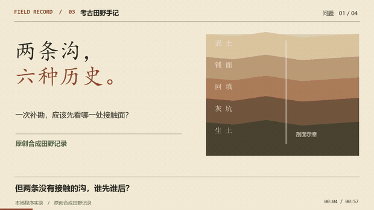

# 地层没有唯一剧本

两条沟如果没有交切记录，怎样告诉读者尚有几种可行历史？把有出处的早晚关系写入有向图，本项目会列出无法比较的层位、定位互相矛盾的原始记录，再从允许触及的界面中挑选下一次补勘位置。

[](demo/demo.mp4)
[播放中文演示](demo/demo.mp4) · [中文字幕](demo/字幕.srt) · [真实命令行时间记录](demo/session.cast)

57 秒。00:14 看双沟剖面的六种合法顺序，00:28 比较第二次补勘的位置，00:43 回到原程序输出。

## 本地一键复演

在仓库根目录运行。使用 Python 3.11 或 3.12 标准库，无需联网或 GPU。入口按脚本位置查找数据，复制或重命名仓库后仍可使用。每次运行会将科研程序和原始输入复制到新的临时目录，重新计算并打印关键读数。

```sh
python -X utf8 demo/replay.py
```

## 打开一本田野账

先看 [四组原创虚构探方记录](附件/trenches.json)。其中的“南北双沟”有两支从生土出发、最后汇合的链。六种拓扑顺序都满足记录。切换到“抄录冲突”，沿 A→B→C→A 找到日记 12、断面 7、转抄 4，可以把矛盾具体交还给记录员。

在第二个实验里，七个单元共有 140 种合法历史。依序检查两处接触面后，按编号选点平均剩 49 种，按回答能否均分候选选点平均剩 35.714 种，最坏分别为 63 和 40。这里的平均值对合法历史赋等权，接触面不可见时仍保留 140 种。[允许补查的接触面](附件/复核实验/survey_plans.json) · [每种隐藏历史的逐步回答](附件/复核实验/all_hidden_orders.csv)

单独检查拓扑关系：

```sh
python -X utf8 附件/analyze.py 附件/trenches.json
```

现场的覆压与扰动关系需要人工核实。算法输出的是给定记录的逻辑后果，示例单位不能换算成年代。

## 研究与演示材料

[一页说明](一页说明.pdf) · [完整研究报告](研究报告.pdf) · [展架海报](海报.pdf) · [答辩幻灯片](答辩.pptx) · [Mira 分轮工作流](附件/Mira%20工作流.md)

视频展示本地 Python 程序的实际复算与输出，图形和中文配音用于解读。Mira 桌面端可按分轮工作流导入相同材料；当前演示不含 Mira 对话分享链接。


[下载独立工作流附件 ZIP](B03-trench-orders-附件包.zip)


[下载 80 × 200 cm 印刷海报 PDF](海报.pdf) · [下载 300 dpi 海报 JPG](海报.jpg)
