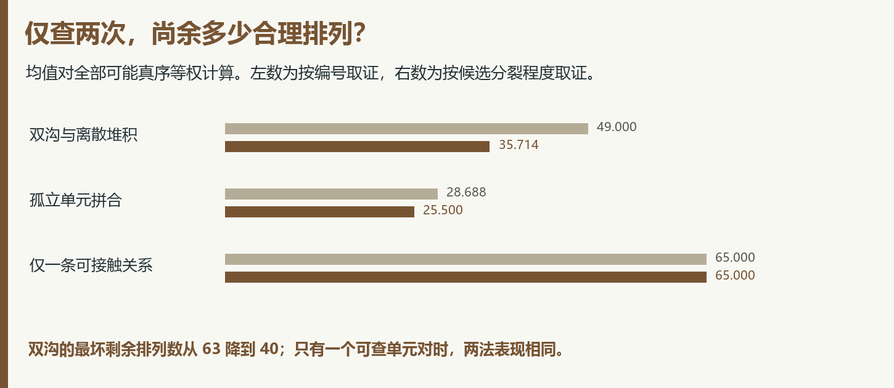

# 地层没有唯一剧本

## 一张剖面图究竟能写成几种历史？

南沟底早于自己的填土，北沟底也早于自己的填土。如果两沟从未接触，把南沟写在北沟之前只是一种可能。作品给出每个结论的证据路径，把尚能成立的时间顺序数出来，并在记录内部冲突时把问题退回到田野记录编号。它服务于地层学教学和小规模发掘记录的内部核查。

研究借鉴 Edward C. Harris 用地层单元关系表达相对先后的做法。本包统一将箭头从早指向晚，研究对象是关系图的逻辑一致性及可推断性。[Harris 关于考古地层学的方法原著](https://harrismatrix.com/about-the-book/)

## 证据袋

`trenches.json` 有四组原创虚构案例。每组列出单元代号与名称，每条关系由“较早单元、较晚单元、观察记录编号”组成。编号用来展示溯源，未指向真实田野档案。四组覆盖连续层序、双支汇合、互不接触的拼方及转抄关系成环。代码、观察样本和计算结果可随作品公开展示、复制和独立复核。

## 推断协议

1. 将同一单元对的多个直接观察归入同一条边，并保留来源。拒绝无名记录、未知地层和超出 1–16 个单元的输入。
2. 对每条边 u→v 搜索 v 回到 u 的路径。找到回路便输出有编号的证据链并停止排年代；记录保留原样。
3. 在有向无环图中，对两单元寻找可达路径。可达即能证明先后，两个方向皆不可达则为不可比。删除一条边后仍存在另一路径时，该边可从最简示意图省去，原观察仍保留在输入中。
4. 以“已排入序列的单元集合”为状态。每步只追加所有前驱都在集合中的单元，对后续方案求和，得到合法总排列数。复杂度随单元数指数增长；不要把这个小图枚举器用于大型遗址全库。

| 项目 | 核查方式 | 整体验收要求 |
| --- | --- | --- |
| 有效单元与方向 | 手读双沟的 N→A→C | 证据链每段均须出现在原始记录里 |
| 无环可比性 | 单独枚举所有置换，筛掉违背直接观察者 | 图推导的可比对数等于全体合法排列一致同意的对数 |
| 排列计数 | 对最多六单元的四例做全排列穷举 | 两种方法对 1、6、30、0 四个计数完全相符 |
| 冲突处置 | 回环首尾核验并查边编号 | 可回查三条原始记录；不强行输出时间线 |

## 发掘记录的剩余自由度

| 探方 | 单元 | 直接关系 | 含推导的可比对 | 不可比对 | 合法排列 |
| --- | ---: | ---: | ---: | ---: | ---: |
| 灰坑剖面 | 5 | 5 | 10 | 0 | 1 |
| 南北双沟 | 6 | 6 | 11 | 4 | 6 |
| 台地拼方 | 5 | 2 | 2 | 8 | 30 |
| 抄录冲突 | 4 | 4 | 停止 | 停止 | 0 |

双沟的 A 与 B、A 与 D、B 与 C、C 与 D 各自可以交换相对位置。N 与 E 则能沿 N→A→C→E 证明先后。台地拼方中 E 没有接触记录，强行给它一个精确层位会丢掉大量同样成立的叙事。

## 哪一笔抄错了？

冲突例中，日记12、断面7、转抄4 分别支持 A→B、B→C、C→A。逐条暂时搁置环内记录，合法排列数分别为 2、3、1；暂时搁置环外的断面9 仍为 0。能消除矛盾的选项有三个，计算结果没有指认证词真伪的能力。若同一事件的多处暴露需先做单元同一化，应由田野人员检查记录后再重建图；代码不推断这一点。

## 重跑

本地核验使用 Windows x64、Intel x64 CPU、CPython 3.11.9。分析仅依赖 Python 标准库，单进程运行，无需 GPU 或联网。解压附件包，在含 `analyze.py` 的目录打开终端。以下命令均以该目录为工作目录。

```powershell
python analyze.py trenches.json
python verify.py
python stress.py
```

第一条打印路径和最简边集。第二条独立穷举并保存 `result.json`，第三条保存搁置证词实验的 `stress.json`。Mira 对话演示采用附件的“田野笔记—推断—交叉检验—复核单”流程。以上数值来自本地运行；正式分享链接由参赛者使用桌面客户端完成自己的运行后生成。

## 复核实验 v2 · 只有两次补勘机会

原实验 v1 与海报说明既有记录容许哪些排列。这里改问现场可以多看哪一对单元。另造三组观察关系，并为每组事先列出可接近的单元对。对每张图的每种合法全序，轮流将其当作未揭晓的真实顺序；一个可判方向的补勘返回该对单元的早晚。三组共有 140 + 96 + 90 = 326 种后台真序。现场人员在选点时只看到剩余候选集合。

基线按单元编号选择第一对仍有争议的可接近单元。新策略让一条观察尽量均分当前候选：若它把 N 种候选分成 k1、k2 种，在各排列等可能时，观察后剩余排列数的期望为 (k1²+k2²)/N。每轮重算该值、选择最小者，平局按编号。这个准则只对当前一步最优。

| 新探方 | 初始排列 | 查两次后基线均值 | 查两次后新策略均值 | 新策略最坏剩余 |
| --- | ---: | ---: | ---: | ---: |
| 双沟与离散堆积 | 140 | 49.000 | 35.714 | 40 |
| 孤立单元拼合 | 96 | 28.688 | 25.500 | 30 |
| 仅一条可接触关系 | 90 | 65.000 | 65.000 | 75 |

第一组中两法首轮都查 A 与 D，均留下 70 种候选。差距源于第二轮对第一轮观察的响应。第三组只有 A 与 F 可查，第一次观察可能留下 75 或 15 种排列；没有新的可接触单元对时，两种策略都停在原集合。若现场看不到接触面、无法判定方向，则应记录“未判”并保留全部候选。模拟未估算实际可判概率、作业成本或全序先验。无接触信息无法证明两个单元同时。

在 `附件/复核实验` 内执行 `python -X utf8 survey.py`。新样本 `survey_plans.json` 的 earlier 是既有记录，permitted 是可接近关系。每个模拟真序在每轮被问哪一对、观察前后剩余数，均见 `all_hidden_orders.csv`。断言逐行核验真序始终保留，并验证单步期望未差于编号基线。数据为原创教学设定，可公开复制与复核。


